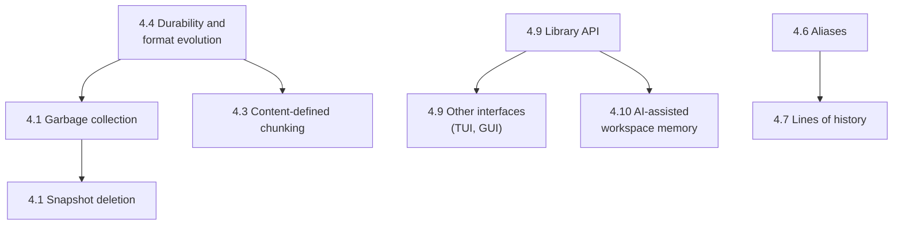

# Snapr Roadmap: Beyond v1

This document describes where Snapr could go after v1. It first states what v1 already does, so that nothing implemented is mistaken for future work, and then sets out possible directions.

Snapr is an engine for reproducing workspace states. The CLI is one interface to that engine; others, such as a TUI or GUI, can be built on the same library.

**Nothing below the v1 summary is a commitment.** No direction has a date or a finished design, and none of it exists in the code. Each direction carries a status label so its standing is clear.

| Label | Meaning |
| --- | --- |
| **Implemented** | Present in v1 and covered by the documentation in [`docs/`](docs/). |
| **Intended** | The maintainer has stated the intent to build this. It has no design and no date. |
| **Previously noted** | Named in the project's earlier planning notes (the pre-v1 README and roadmap, kept in the Git history), or present as a stub or comment in the code. This shows intent at some point. It is not a decision to build it. |
| **Possible direction** | A plausible extension with no record of earlier intent. Listed for discussion only. |

**Contents**

1. [What v1 implements](#1-what-v1-implements)
2. [Known limitations of v1](#2-known-limitations-of-v1)
3. [Status at a glance](#3-status-at-a-glance)
4. [Directions](#4-directions)
5. [How the directions depend on each other](#5-how-the-directions-depend-on-each-other)
6. [Out of scope](#6-out-of-scope)
7. [Guiding principles](#7-guiding-principles)

---

## 1. What v1 implements

**Storage engine**

- Fixed-size chunking at 4 MiB, reading files as a stream of chunks.
- SHA-256 content addressing: an object is named by the hash of its uncompressed chunk.
- Zstandard compression, with a 16-byte object header carrying a magic value, version, flags, compression type, and original size.
- Chunk-level deduplication within a file, across files, and across snapshots.
- A workspace index that skips files whose size and modification time are unchanged.
- File-level parallelism for hashing and storing, and file- and chunk-level parallelism for verification.

**Snapshots**

- Each snapshot is a complete manifest of the workspace: every file with its ordered chunk hashes.
- Each snapshot records its parent, the snapshot the workspace was on when it was saved. Saving after restoring an older snapshot produces a second line of history from that snapshot.
- Per-snapshot statistics describing what the save stored.

**Commands**

| Command | Capability |
| --- | --- |
| `init` | Create a repository. |
| `save` | Store new content and record a snapshot. |
| `status` | Show changes between the workspace and the current snapshot. |
| `diff` | Show files added, modified, and removed between two snapshots. |
| `restore` | Make the workspace match a snapshot, rewriting only what differs. `--dry-run` previews the counts; `--force` allows restoring the current snapshot. |
| `history` | List snapshots with their parent, time, and statistics. |
| `verify` | Check every referenced chunk, list each integrity issue, and exit non-zero if any is found. |

**Project structure**

- A library crate with the CLI as a thin layer over it. Command handlers return typed reports and a separate module renders them.
- Optional timing instrumentation behind the `benchmark` feature.
- Unit and integration test suites.
- Documentation of the [architecture](docs/architecture.md), [storage format](docs/storage-format.md), [verification design](docs/verification.md), and [benchmarking](docs/benchmarking.md).

**Present in the format but not used.** These exist in v1's data structures and are easy to mistake for features:

- The object header's version byte, flags byte, and a compression identifier for "none" are defined. v1 writes one combination and its readers do not check the version or flags.
- `config.json` has a format `version` that is written and never read.
- `parent_id` forms a tree, but no command walks it. There are no branch names and no merge.

---

## 2. Known limitations of v1

The directions in section 4 respond to these. The full list is in [architecture.md, section 13](docs/architecture.md#13-known-limitations-of-v1) and [storage-format.md, section 11](docs/storage-format.md#11-compatibility-and-versioning-limitations).

| Area | Limitation |
| --- | --- |
| Storage growth | Objects and snapshots are never deleted. |
| Deduplication | Fixed chunk boundaries: inserting bytes near the start of a large file changes every later chunk of that file. |
| Durability | Repository files are written in place, with no atomic replace and no lock against a second Snapr process. |
| Format evolution | Version fields are not checked, unknown JSON keys are dropped on rewrite, and the header cannot be extended. |
| Scale | One JSON file holds all snapshots and is parsed by every command; all objects share one flat directory. |
| Scope of capture | File content only. Permissions, timestamps, symbolic links, and empty directories are not recorded. |
| Portability | Paths use the host's separator, and the repository must be used from the workspace root. |
| Restore safety | Restore overwrites and deletes without confirmation and does not check chunk hashes as it reads. |
| Library use | Paths depend on the process working directory, errors are untyped strings, and report types are not serializable. |
| Confidentiality | Objects and metadata are stored unencrypted. Encryption is [out of scope](#6-out-of-scope). |

---

## 3. Status at a glance

| Capability | Status | Section |
| --- | --- | --- |
| Garbage collection | Previously noted | [4.1](#41-garbage-collection-and-snapshot-deletion) |
| Snapshot deletion | Possible direction | [4.1](#41-garbage-collection-and-snapshot-deletion) |
| Measured repository size, index rebuild | Previously noted (code stubs) | [4.2](#42-repository-maintenance) |
| Content-defined chunking | Previously noted | [4.3](#43-content-defined-chunking) |
| Atomic writes, locking, format version checks | Possible direction | [4.4](#44-durability-and-format-evolution) |
| Storage and performance improvements | Mixed; see section | [4.5](#45-storage-and-performance) |
| Aliases for snapshot ids | Intended | [4.6](#46-richer-snapshot-inspection) |
| Snapshot inspection (`show`), tags, search | Previously noted | [4.6](#46-richer-snapshot-inspection) |
| History tree, detailed dry run, file-level issue reports | Possible direction | [4.6](#46-richer-snapshot-inspection) |
| Snapshot ancestry | **Implemented** | [1](#1-what-v1-implements) |
| Working on separate lines of history from a shared root | Intended as a model; commands undesigned | [4.7](#47-branching-related-workflows) |
| Ignore file, export/import, richer snapshot metadata | Previously noted | [4.8](#48-capture-and-usability) |
| File metadata, per-path restore, safer restore | Possible direction | [4.8](#48-capture-and-usability) |
| Library API suitable for other front ends | Possible direction; a stability policy is expected | [4.9](#49-library-api-and-other-interfaces) |
| Graphical or terminal UI client | Previously noted; a potential community contribution | [4.9](#49-library-api-and-other-interfaces) |
| AI-assisted workspace memory | Intended (part of the project's vision) | [4.10](#410-ai-assisted-workspace-memory) |
| Encryption | Out of scope | [6](#6-out-of-scope) |

---

## 4. Directions

Each direction states the problem it would address and the parts of v1 it could build on. "Open questions" are points that would need a decision before design work could start.

### 4.1 Garbage collection and snapshot deletion

**Status:** garbage collection is previously noted (as `snapr gc`). Snapshot deletion is a possible direction.

**Problem.** A repository only grows. An interrupted save can leave objects that no snapshot uses, and there is no way to drop a snapshot that is no longer wanted and reclaim its space.

**Builds on.**

- `verify` already computes the set of every chunk hash referenced by any snapshot. Unreferenced objects are the files in `.snapr/objects/` outside that set.
- Objects are immutable and named by content, so removing an unreferenced object cannot affect any snapshot.
- Snapshots are complete manifests, so deleting one does not change how any other snapshot restores.

**Open questions.**

- Collection must not run while a save is writing objects that are not yet referenced, which points to the repository lock in [4.4](#44-durability-and-format-evolution).
- Snapshot deletion has not been designed. Any design has to keep the rule that every snapshot traces back to the root, so it must say what happens to the children of a deleted snapshot.
- The workspace index assumes every hash it lists is in the store. Deleting snapshots and collecting their objects could break that assumption, so the index would need pruning or resetting.

### 4.2 Repository maintenance

**Status:** previously noted. `object_store_size` and `rebuild_workspace_index` exist as unimplemented stubs.

**Problem.** The reported storage total is a counter accumulated across saves, not a measurement, and it cannot notice objects removed or added by other means. There is also no command to regenerate the workspace index.

**Builds on.** The two stubs mark where this code would go. `verify` already walks the referenced objects, and an unused `reset_workspace_index` function exists.

**Related possible direction.** `verify` could be widened to check the ancestry graph and the metadata files and to report unreferenced objects. Today it checks referenced objects only.

### 4.3 Content-defined chunking

**Status:** previously noted. The earlier roadmap listed "continue toward content-defined chunking" as engine work after the CLI.

**Problem.** With fixed 4 MiB boundaries, inserting or deleting bytes shifts every later boundary in the file, so the rest of the file is stored again. Chunk boundaries chosen from the content would let unchanged regions keep their chunks.

**Builds on.**

- Chunking is isolated in `ChunkReader`. Both the save path and the hash-only path obtain chunks from it.
- Nothing downstream assumes a chunk size. A manifest is an ordered list of hashes, each object records its own length, and restore concatenates chunks. Existing snapshots would remain readable.

**Open questions.**

- The chunk size is not recorded in the repository. Chunks produced by a new algorithm would not deduplicate against existing fixed-size objects, so a repository would hold both kinds.
- The choice of algorithm and its size parameters, and whether they are fixed or configurable per repository.
- Variable chunk sizes change the memory and performance profile described in the benchmarking document.

### 4.4 Durability and format evolution

**Status:** possible direction. These follow from v1's documented limitations; no earlier note mentions them.

**Problem.** An interrupted write can truncate a repository file. Two processes can overwrite each other's changes. A v1 binary cannot tell that a repository or object was written by a different format version.

**Possible work.**

- Write repository files to a temporary name and rename them into place.
- Take a repository lock for the duration of a writing command.
- Read the existing `version` fields and refuse, or migrate, anything unrecognized.
- Use one object reader for both restore and verify, so both apply the same checks.

**Builds on.** The version byte, flags byte, and `config.version` are already written into every v1 repository, so a later release can distinguish v1 data.

**Why it matters for the rest.** Any change to the object or metadata format, including [4.3](#43-content-defined-chunking), is safer once readers check versions.

### 4.5 Storage and performance

**Status:** mixed. Streaming restore is previously noted (the earlier roadmap, and a comment in the restore code). The rest are possible directions drawn from the v1 documentation.

| Idea | Problem it addresses | Builds on |
| --- | --- | --- |
| Verify chunk hashes during restore | A damaged object can be restored without warning. | `verify_chunk` already performs the check. |
| Parallel file restoration | Restore writes files one at a time. | Rayon is already used for save and verify. |
| Streaming restore | Each chunk is fully decompressed in memory before being written. | Objects are independent Zstandard streams. |
| Check the store before compressing | A chunk that is already stored is still compressed before that is discovered. | The hash is known before compression. |
| One file per snapshot, or an indexed store | `snapshots.json` is parsed by every command and rewritten on every save. | Snapshots are already self-contained. |
| Fan-out of the object directory | All objects are in one directory. | Object names are uniformly distributed hashes. |
| Sub-second modification times in the index | A same-size edit within one second can be missed. | The index already stores a modification time. |

None of these has been measured. The [benchmarking document](docs/benchmarking.md) explains why no performance figures exist yet; establishing them would be the first step before prioritizing any item in this table.

### 4.6 Richer snapshot inspection

**Status:** aliases for snapshot ids are intended. `snapr show`, tags, and message search are previously noted. The other items are possible directions.

**Problem.** v1 can list snapshots and compare two of them, but it cannot show one snapshot in detail, refer to a snapshot by anything other than its number, or say which files an integrity issue affects.

| Idea | Status | Builds on |
| --- | --- | --- |
| `snapr show <id>`: message, time, statistics, and changes from the parent | Previously noted | All of this is in the snapshot record; the comparison function already exists. |
| Aliases for snapshot ids, such as `snapr restore stable` | Intended | Snapshots are looked up by id in one place per command. |
| Tags on snapshots | Previously noted | The snapshot record can carry additional fields. |
| Search snapshot messages | Previously noted | Messages are stored in each snapshot. |
| History drawn as a tree | Possible direction | `parent_id` already defines the tree. |
| A dry run that lists the affected files | Possible direction | Restore already computes the full list and reports only counts. |
| Verification issues that name affected files and snapshots | Possible direction | The verifier knows which file first references each chunk. |
| Content-level diff for text files | Possible direction | Nothing specific; `diff` is file-level today. |

### 4.7 Branching-related workflows

**Status:** recording ancestry is **implemented**. The model below is the maintainer's stated intent. The commands that would support it have not been designed.

**The model.** Snapr's lines of history are not Git branches.

- Every snapshot traces back to the single root snapshot. v1 already upholds this, and it remains a rule for anything built here.
- A line of history starts when someone restores an existing snapshot and saves from it. A person who wants to do their own work branches out from an existing snapshot id and continues from there.
- Snapshots are referred to by id, and ids are intended to have aliases ([4.6](#46-richer-snapshot-inspection)).

**Problem.** v1 records diverging lines accurately, but offers no way to list the tips of those lines or to move between them other than by snapshot number.

**Builds on.**

- `parent_id` and the current-snapshot pointer already describe a tree and a position in it.
- The tips are the snapshots that no other snapshot names as its parent, which can be computed from `snapshots.json`.
- Aliases would give a line's tip a readable name.

**Not proposed.** Combining two lines of history into one. Merging file contents is a source-collaboration feature and is outside Snapr's purpose.

### 4.8 Capture and usability

**Status:** the ignore file, export/import, and extra snapshot metadata are previously noted. The rest are possible directions.

| Idea | Status | Problem it addresses | Builds on |
| --- | --- | --- | --- |
| `.snaprignore` | Previously noted | Ignore rules are hardcoded. | A single function decides what the directory walk skips. |
| Export and import of a repository as one archive | Previously noted | A repository cannot be handed to someone else as a unit. | The repository is one self-contained directory. |
| Snapshot metadata such as author or host name | Previously noted | A snapshot records only a message and time. | Unknown JSON keys are ignored by v1 readers, though they are dropped on rewrite. |
| File permissions, timestamps, symbolic links | Possible direction | A restore reproduces content only. | The file entry would need new fields. |
| Normalized path separators | Possible direction | Repositories do not move between operating systems. | Paths are produced in one place. |
| Running from any subdirectory | Possible direction | Commands work only at the workspace root. | Repository paths are defined as constants in one module. |
| Restore of a single file or directory | Possible direction | Restore always targets the whole workspace. | `restore_file` already rebuilds one file from its hashes. |
| Confirmation before a destructive restore | Possible direction | Unsaved and never-saved files are lost without warning. | Restore already knows what it will overwrite and delete. |

### 4.9 Library API and other interfaces

**Status:** a graphical client is previously noted; the earlier roadmap listed "GUI" in its long-term vision and cited GUI, TUI, and web front ends as the reason for separating reports from rendering. **No client other than the CLI exists.**

Snapr is the engine. The CLI is the most convenient way to drive it during development, and it is one interface among possible others. A TUI or GUI would **link the `snapr` library crate** and present the same reports in its own way.

A graphical client is a potential **community contribution built around the existing core**, not a rewrite of it. The core's part is to be a dependable library for such a client to call.

**Problem.** Snapr is usable only from a terminal. The library crate was shaped by the needs of the CLI and the tests, and several of its properties get in the way of another interface.

**Builds on.**

- The package already builds a library crate, and the CLI is a thin caller of it.
- Every command handler returns a typed report; rendering is a separate module that a client would replace.
- The snapshot list, with `id` and `parent_id`, is enough to draw history as a tree.
- [architecture.md, section 14](docs/architecture.md#14-building-on-snapr-as-a-library) maps user actions to library calls.

**Core work that would make a client practical** (possible directions):

| Change | Why a client needs it |
| --- | --- |
| Pass the repository location as a parameter | v1 resolves all paths from the process working directory, so one process cannot handle two repositories. |
| Typed errors | A client cannot react differently to "not initialized" and "snapshot not found" when both are strings. |
| Serializable report types | Useful to a client that passes reports between its own components. |
| Progress reporting and cancellation | Long saves, restores, and verifications give no feedback and cannot be stopped. |
| No terminal output outside the rendering module | One handler still writes a message to standard error. |
| A stability policy for the library | A statement of which library items client authors can rely on between releases, and how changes to them are announced. One is expected; it has not been written. |

### 4.10 AI-assisted workspace memory

**Status:** intended. It has been part of the project's vision since the earliest notes. It has no design.

**The idea.** Give AI models context about how a workspace has evolved over time. For example, a media company working on a film could ask how the work has changed since the project began.

**Problem.** A model looking at a workspace sees only its present state. The history of what changed, when, and in what order is exactly what a snapshot repository holds, but v1 exposes it only as terminal output for a person to read.

**Builds on.**

- Every snapshot records a message, a time, its parent, and statistics about what the save stored.
- Any two snapshots can be compared to list the files added, modified, and removed between them.
- Any earlier state can be restored exactly, so a past version of a file can be retrieved.
- The library crate returns this information as typed data.

**Open questions.** What form the context takes, how a model would request it, and how much of it comes from snapshot metadata as opposed to file contents.

---

## 5. How the directions depend on each other

Some directions are much easier, or only safe, after others.

- **Durability and format versioning come first** for anything that changes what is written to disk or allows a second writer.
- **Garbage collection precedes snapshot deletion**, since deleting a snapshot is only useful if its space can be reclaimed.
- **The library API precedes other interfaces**, and anything else that consumes Snapr's data programmatically.
- **Inspection features are largely independent** and can be taken up in any order.

An arrow means "is made easier or safer by", not "is scheduled after".

---

## 6. Out of scope

These are not directions for Snapr.

- **Encryption.** Snapr stores objects and metadata unencrypted, and encrypting them is not planned.
- **Source-code collaboration.** Snapr is not an alternative to Git or to hosting services built on it. Features whose purpose is collaborating on source code, such as merging, are outside its purpose.

---

## 7. Guiding principles

These have guided v1 and would apply to any of the directions above.

- Snapr is an engine. The CLI is one interface to it, not the product.
- Business logic never prints. Commands orchestrate and return reports; the rendering module displays them.
- Snapshots stay lightweight: content lives in the object store, metadata in the manifest.
- Favor deduplication, and design for large files.
- Restoration accuracy comes first.
- Every piece of CLI output should teach the user how Snapr thinks.
- Snapr's purpose is reproducing complete working states, not source-code collaboration.
