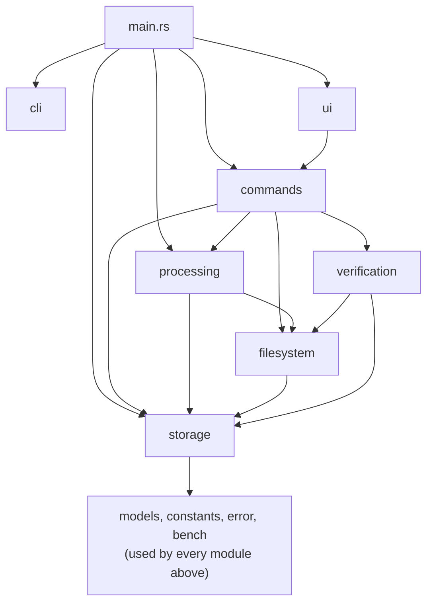
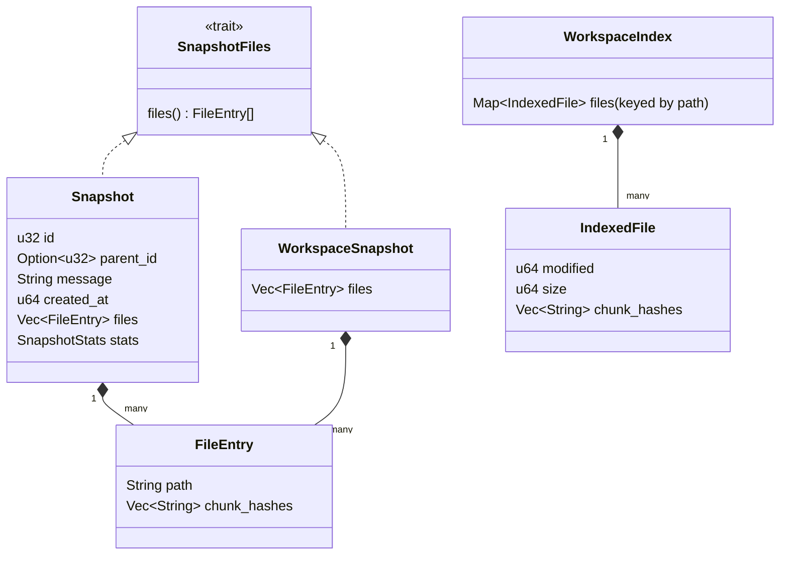
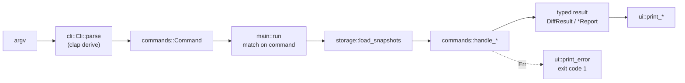
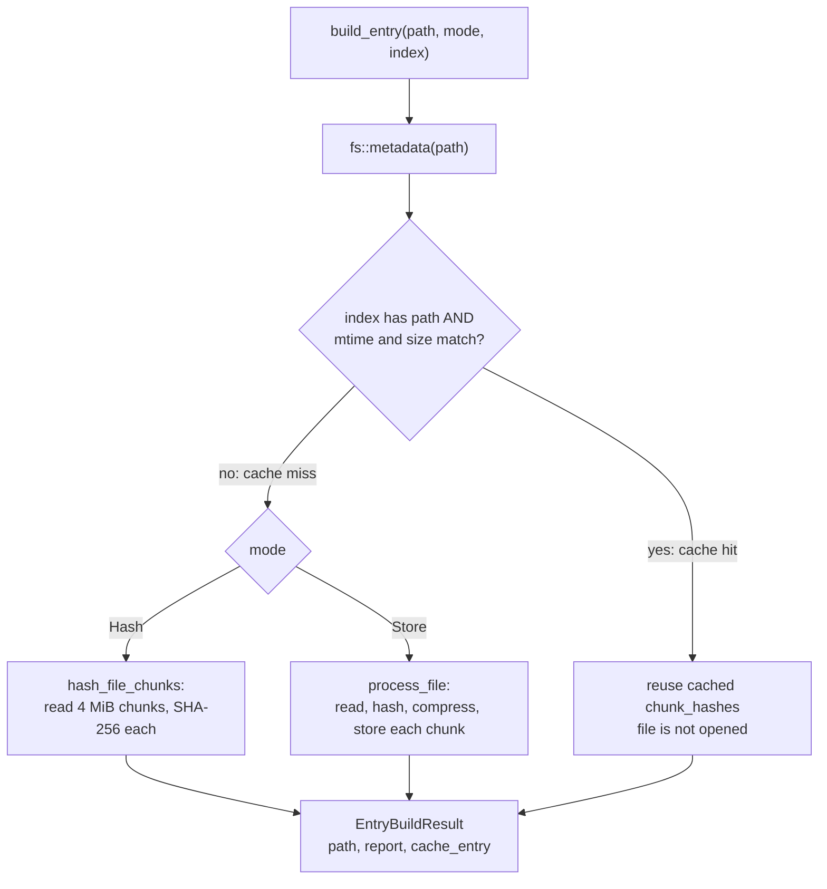
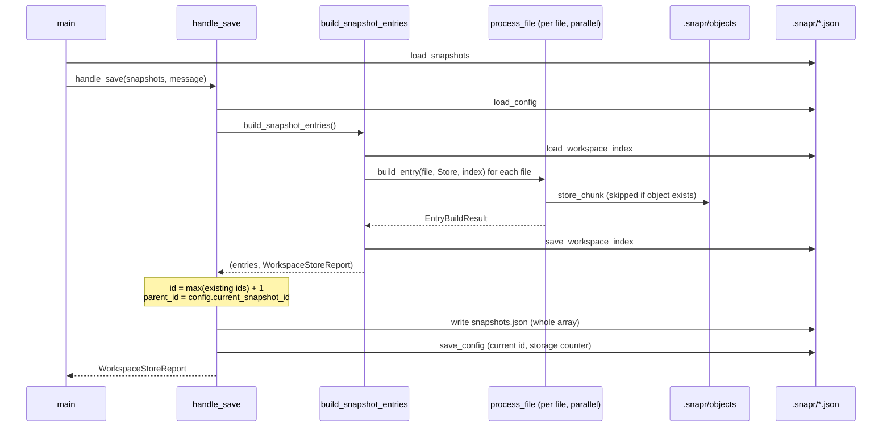
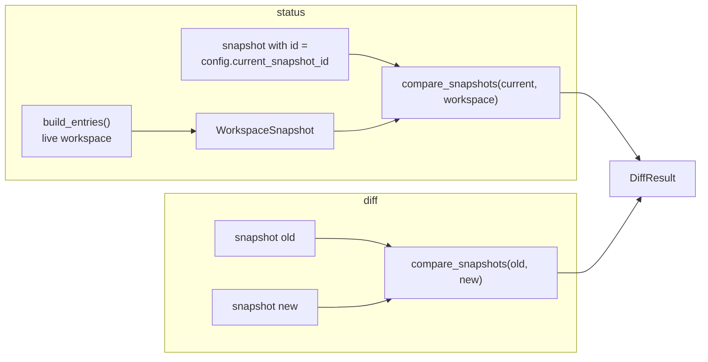
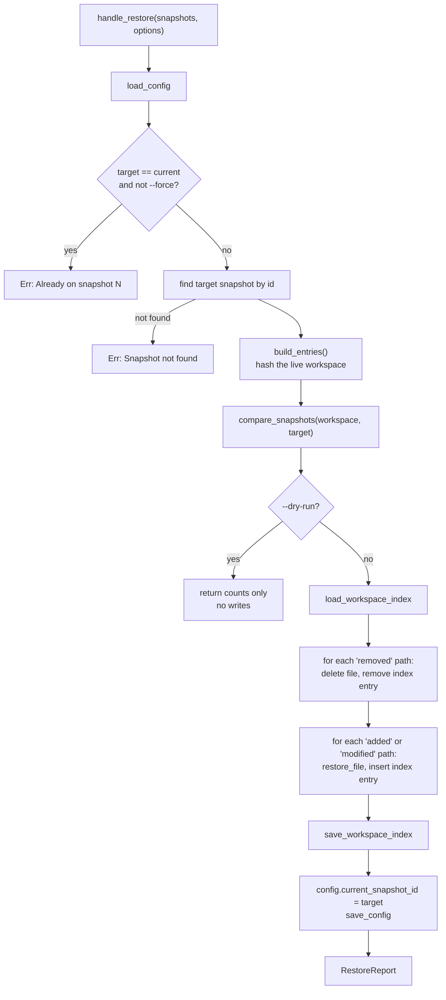
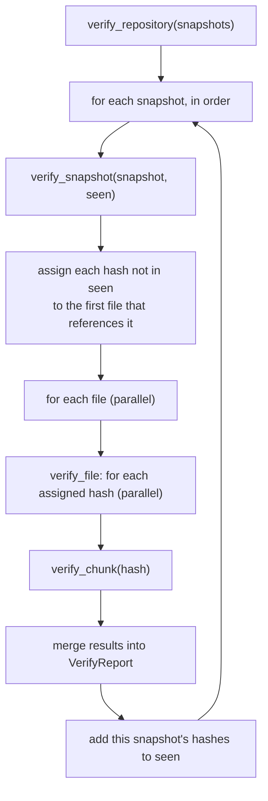
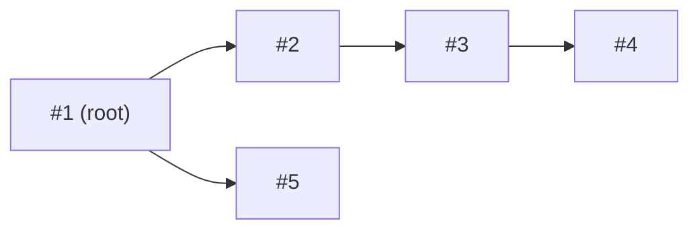

# Snapr Architecture

This document describes how Snapr v1 is built: its modules, its on-disk state, and what each command does from argument parsing to terminal output. It is written for people who want to understand Snapr, contribute to its core, or build another front end (such as a GUI) on top of it.

Everything here describes behavior that exists in the source tree, unless it appears under a heading or callout marked **Not implemented**. Where the code and older planning notes disagree, this document follows the code.

**Contents**

1. [Purpose and design summary](#1-purpose-and-design-summary)
2. [Repository layout on disk](#2-repository-layout-on-disk)
3. [Module structure](#3-module-structure)
4. [Core data model](#4-core-data-model)
5. [Request flow: CLI → command → UI](#5-request-flow-cli--command--ui)
6. [Command lifecycles](#6-command-lifecycles)
7. [The workspace index](#7-the-workspace-index)
8. [Snapshot ancestry and `parent_id`](#8-snapshot-ancestry-and-parent_id)
9. [Parallel processing](#9-parallel-processing)
10. [Benchmark instrumentation](#10-benchmark-instrumentation)
11. [Architectural invariants](#11-architectural-invariants)
12. [Design decisions and trade-offs](#12-design-decisions-and-trade-offs)
13. [Known limitations of v1](#13-known-limitations-of-v1)
14. [Building on Snapr as a library](#14-building-on-snapr-as-a-library)
15. [Not implemented](#15-not-implemented)
16. [Test map](#16-test-map)

---

## 1. Purpose and design summary

Snapr captures the state of a directory tree (the *workspace*) as numbered *snapshots* and can later compare, restore, and verify them. It is a local, single-user tool. There is no remote, no merge, and no staging area.

The design rests on four ideas:

| Idea | What it means in Snapr |
| --- | --- |
| **Content-addressed chunks** | Each file is split into fixed-size 4 MiB chunks. Each chunk is hashed with SHA-256, and the hex digest is the name of the object that stores it. |
| **Snapshots are full manifests** | A snapshot lists every tracked file and the ordered chunk hashes that make it up. It holds no file content and is not a delta against its parent. |
| **Deduplication by construction** | A chunk whose hash already exists in the object store is not written again, whichever file or snapshot it came from. |
| **Metadata cache for speed** | A workspace index remembers each file's size, modification time, and chunk hashes so that unchanged files are not re-read. |

### Commands

| Command | Effect | Writes to disk |
| --- | --- | --- |
| `snapr init` | Creates an empty repository in `./.snapr`. | `.snapr/*` |
| `snapr save <message>` | Stores new chunks and appends a snapshot. | objects, index, snapshots, config |
| `snapr status` | Compares the workspace with the current snapshot. | nothing |
| `snapr diff <old> <new>` | Compares two snapshots. | nothing |
| `snapr restore <id> [--force] [--dry-run]` | Makes the workspace match a snapshot. | workspace files, index, config (nothing with `--dry-run`) |
| `snapr history` | Lists snapshots and marks the current one. | nothing |
| `snapr verify` | Checks every chunk referenced by any snapshot. | nothing |

---

## 2. Repository layout on disk

All repository state lives in `.snapr/` in the directory where `snapr init` was run. Paths are defined as constants in [`src/constants.rs`](../src/constants.rs).

```text
.snapr/
├── config.json            current snapshot pointer and storage counter
├── snapshots.json         JSON array of every snapshot, in creation order
├── workspace_index.json   per-file metadata cache (see section 7)
└── objects/
    └── <sha256-hex>       one file per unique chunk, flat directory
```

> **Paths are relative to the process working directory.** Snapr does not search parent directories for `.snapr`. Running a command from a subdirectory of the workspace fails with `Snapr not initialized`.

### Object format

Each object is a 16-byte header followed by the Zstandard-compressed chunk. The writer is `compress_chunk` in [`src/filesystem/compress.rs`](../src/filesystem/compress.rs); the parser is `ObjectHeader::extract` in [`src/storage/models/object_header.rs`](../src/storage/models/object_header.rs).

| Offset | Size | Field | Value written in v1 |
| --- | --- | --- | --- |
| 0 | 5 | Magic | `SNAPR` |
| 5 | 1 | Format version | `1` |
| 6 | 1 | Flags | `0` (none defined) |
| 7 | 1 | Compression type | `1` (Zstd). `0` (None) is defined but never written. |
| 8 | 8 | Original (uncompressed) size | little-endian `u64` |
| 16 | … | Payload | Zstd frame, compression level 3 |

The object's filename is the SHA-256 of the **uncompressed** chunk bytes, so the name does not depend on the compression settings.

### `config.json`

Modeled by `SnaprConfig` in [`src/models/config.rs`](../src/models/config.rs).

| Field | Meaning |
| --- | --- |
| `version` | Repository format version. Always `1`. It is written but not checked on load. |
| `current_snapshot_id` | The snapshot the workspace is considered to be "on". Absent or `null` until the first save. |
| `total_storage_bytes` | Running sum of the object bytes each save reported as newly written. It is a counter, not a measurement of the `objects/` directory. |

---

## 3. Module structure

Snapr is one Cargo package with a library crate (`snapr`, [`src/lib.rs`](../src/lib.rs)) and a thin binary ([`src/main.rs`](../src/main.rs)) that depends on it.

| Module | Responsibility | Key items |
| --- | --- | --- |
| `main.rs` | Parses arguments, dispatches to a handler, passes the result to a UI function, and maps errors to exit code 1. | `run` |
| `cli` | The `clap` parser definition. | `Cli` |
| `commands` | One handler per command. Handlers orchestrate the lower layers and return typed results. They do not format output. | `Command`, `handle_*`, `compare_snapshots`, `DiffResult`, `RestoreOptions` |
| `processing` | Turns the workspace into a list of `FileEntry` values. Decides per file whether to use the index or re-read the file. | `build_entries`, `build_snapshot_entries`, `build_entry`, `EntryMode` |
| `filesystem` | Operations on file content: walking the tree, hashing, compressing, and writing restored files. | `collect_files`, `hash_chunk`, `compress_chunk`, `restore_file` |
| `storage` | Reads and writes everything under `.snapr/`. | `store_chunk`, `read_chunk`, `load_snapshots`, `load_config`, `save_config`, `load_workspace_index`, `save_workspace_index`, `ObjectHeader` |
| `verification` | Integrity checking of objects against snapshots. | `verify_repository`, `verify_snapshot`, `verify_file`, `verify_chunk` |
| `models` | Plain data types shared by all layers. | `Snapshot`, `FileEntry`, `WorkspaceSnapshot`, `SnapshotFiles`, `WorkspaceIndex`, `IndexedFile`, `ChunkReader`, `SnaprConfig`, report and result structs, `VerifyIssue` |
| `ui` | Terminal rendering of the typed results. The only module meant to print. | `print_*` |
| `bench` | Optional timing instrumentation behind the `benchmark` feature. | `scoped_timer!`, `benchmark!`, `ScopedTimer` |
| `constants`, `error` | Paths and header constants; the crate-wide result alias. | `SnaprResult<T>` |

### Dependencies between modules



Notes on the edges:

- `filesystem → storage` exists because `restore_file` calls `storage::read_chunk`.
- `ui → commands` exists only because `DiffResult` is defined in `commands::models`.
- `verification` uses `filesystem::hash::hash_chunk_bytes` and `storage::models::ObjectHeader`. It reads object files itself and does not go through `storage::read_chunk`.
- Two handlers write repository files directly instead of through `storage`: `handle_init` creates the initial files, and `handle_save` writes `snapshots.json`. There is a `load_snapshots` but no `save_snapshots`.

### Empty and stub files

These exist in the tree but carry no behavior:

- `src/filesystem/chunk_reader.rs`, `src/processing/cache.rs`, `src/verification/engine.rs`, and `src/verification/models/mod.rs` are empty.
- `storage::object_store::object_store_size` and `storage::workspace_index::rebuild_workspace_index` are `todo!()` and are never called.
- `storage::workspace_index::reset_workspace_index` is implemented but has no caller.

The working chunk reader is `ChunkReader` in [`src/models/chunk.rs`](../src/models/chunk.rs).

---

## 4. Core data model



- **`Snapshot`** is persisted in `snapshots.json`. `created_at` is Unix seconds (UTC).
- **`FileEntry`** is the unit of comparison. `path` is the file's path relative to the workspace root, as produced by the directory walk. `chunk_hashes` is ordered; concatenating the chunks in order reproduces the file. An empty file has an empty list.
- **`WorkspaceSnapshot`** is an in-memory, never-persisted view of the live workspace. It exists so that the workspace and a saved snapshot can be compared by the same function through the `SnapshotFiles` trait.
- **`SnapshotStats`** records what the save that created the snapshot did. See [the note on statistics](#what-the-save-statistics-mean).

Chunks move through three types as they are processed ([`src/models/chunk.rs`](../src/models/chunk.rs)):

```text
Chunk { index, bytes }
   └─ hash_chunk ─▶ HashedChunk { index, hash, bytes }
                       └─ compress_chunk ─▶ CompressedChunk { index, hash, object_bytes, original_size }
                                               └─ store_chunk ─▶ ChunkStoreResult { hash, stored, original_size, stored_size }
```

---

## 5. Request flow: CLI → command → UI

Every command follows the same three-stage shape. The handler returns a typed value and a separate UI function renders it.



| Command | Handler | Returns | Renderer |
| --- | --- | --- | --- |
| `init` | `handle_init()` | `()` | `print_init_success` |
| `save` | `handle_save(&mut snapshots, message)` | `WorkspaceStoreReport` | `print_workspace_store_report` |
| `status` | `handle_status(&snapshots, entries)` | `DiffResult` | `print_status` |
| `diff` | `handle_diff(&snapshots, old, new)` | `DiffResult` | `print_diff` |
| `restore` | `handle_restore(&snapshots, options)` | `RestoreReport` | `print_restore_report` or `print_restore_dry_run_report` |
| `history` | `handle_history(&snapshots)` | current snapshot id | `print_history` |
| `verify` | `handle_verify(&snapshots)` | `VerifyReport` | `print_verify_report` |

Details worth knowing:

- `main::run` loads `snapshots.json` for every command except `init` and passes the vector to the handler. For `status` it also calls `processing::build_entries` itself and passes the result in.
- Errors are `Box<dyn Error + Send + Sync>` (`SnaprResult<T>`). Most are created from string literals. Any `Err` prints `✗ <message>` to stderr and exits with code 1.
- The handler/renderer split is not perfectly clean in v1. Two places outside `ui` write to the terminal:
  - `handle_status` prints `No snapshots yet` to stderr when there is no current snapshot.
  - `ScopedTimer` prints to stdout when the `benchmark` feature is enabled.

---

## 6. Command lifecycles

### 6.1 Building workspace entries (shared by save, status, and restore)

Three commands need to know what the workspace currently contains. They all go through [`src/processing/builder.rs`](../src/processing/builder.rs), which has two entry points that differ in what they do on a cache miss and whether they persist the index.

| | `build_entries()` | `build_snapshot_entries()` |
| --- | --- | --- |
| Used by | `status`, `restore` | `save` |
| Mode | `EntryMode::Hash` | `EntryMode::Store` |
| On a cache miss | chunk + hash only (`hash_file_chunks`) | chunk + hash + compress + store (`process_file`) |
| Writes objects | no | yes |
| Saves the index | **no** | **yes** |

Both start with `collect_files()` ([`src/filesystem/collect.rs`](../src/filesystem/collect.rs)), which walks `.` and returns every regular file, skipping:

- directories named `.git`, `target`, or `.snapr` at any depth, with everything under them;
- files named `.DS_Store`;
- anything that is not a regular file. Symbolic links are not followed and not recorded, and empty directories are not recorded.

These rules are hardcoded. Directory entries that cannot be read are skipped without an error.

For each collected path, `build_entry` ([`src/processing/planner.rs`](../src/processing/planner.rs)) decides:



### 6.2 Save

Handler: [`src/commands/save.rs`](../src/commands/save.rs).



The per-chunk pipeline inside `process_file` ([`src/processing/file.rs`](../src/processing/file.rs)):

1. `ChunkReader::next_chunk` reads up to `DEFAULT_CHUNK_SIZE` (4 × 1024 × 1024 bytes). Only the final chunk of a file can be shorter.
2. `hash_chunk` computes the SHA-256 of the raw bytes.
3. `compress_chunk` compresses with Zstd level 3 and prepends the 16-byte header.
4. `store_chunk` creates `.snapr/objects/<hash>` with an exclusive create (`create_new`). If the object already exists, nothing is written. The return value says whether the chunk was new (`stored: true`) or reused.

Disk writes happen in this order: objects, then `workspace_index.json`, then `snapshots.json`, then `config.json`. Each is a plain `fs::write`; the sequence is not transactional (see [limitations](#13-known-limitations-of-v1)).

`save` always creates a snapshot, even when nothing has changed.

#### What the save statistics mean

`WorkspaceStoreReport` (printed after a save) and `SnapshotStats` (stored in the snapshot) are filled only from files that were actually re-processed. A file that hits the index contributes an empty report.

| Field | Counts |
| --- | --- |
| `files_processed` / `file_count` | **All** files in the snapshot, including cache hits. |
| `chunks_processed` / `chunk_count`, `processed_bytes` / `workspace_bytes` | Only chunks of files that missed the index. |
| `new_chunks`, `reused_chunks` | Only chunks of files that missed the index. A reused chunk is one that was hashed and found already present. |
| `new_storage_bytes` | Size of the objects written, headers included. |
| `total_storage_bytes` (stats only) | `config.total_storage_bytes` before this save plus this save's `new_storage_bytes`. |

So a save with no changes reports the full file count with zero chunks and zero bytes. `chunk_count` and `workspace_bytes` are not the size of the snapshot.

The "Compression saved" line printed by the UI is `100 × (1 − new_storage_bytes / processed_bytes)`. It therefore combines compression and deduplication, and it is negative when the header and Zstd framing outweigh the savings, as with very small files.

### 6.3 Status and diff

Both commands produce a `DiffResult { added, modified, removed }` using one function, `compare_snapshots(from, to)` in [`src/commands/helpers.rs`](../src/commands/helpers.rs). It builds a `path → chunk_hashes` map for each side and classifies each path:

| Condition | Classification |
| --- | --- |
| path in `to` only | added |
| path in both, chunk hash lists differ | modified |
| path in `from` only | removed |

Paths are compared as exact strings. There is no rename detection: a renamed file appears as one removal and one addition. Each output list is sorted.



**Status** ([`src/commands/status.rs`](../src/commands/status.rs)) compares the current snapshot (`from`) with the live workspace (`to`). "Added" means present in the workspace but not in the current snapshot. It uses `build_entries`, so it reads the index but never writes it or the object store. If no snapshot has been saved yet, the handler returns an empty diff and the output reads as a clean workspace.

**Diff** ([`src/commands/diff.rs`](../src/commands/diff.rs)) compares two stored manifests and never touches the workspace or the object store. It rejects id `0` and unknown ids. The arguments are used in the order given; they are not reordered by id.

### 6.4 Restore

Handler: [`src/commands/restore.rs`](../src/commands/restore.rs).



Restore is a diff-driven sync. The comparison runs from the live workspace to the target, so:

- **added** and **modified** paths are (re)written from the object store;
- **removed** paths (present in the workspace, absent from the target) are deleted;
- every other file in the target is already identical and is counted as *skipped*.

`restore_file` ([`src/filesystem/restore.rs`](../src/filesystem/restore.rs)) creates parent directories, truncates or creates the file, and appends each chunk in order. `storage::read_chunk` checks the object's length and magic bytes and then Zstd-decodes the payload.

Behavior to be aware of:

- **Restore discards unsaved work without asking.** Files that differ from the target are overwritten, and files that are not in the target are deleted, including files that were never part of any snapshot. Use `--dry-run` first to see the counts.
- `--dry-run` returns after the comparison. It changes no files, no index, and no config.
- `--force` only bypasses the "already on snapshot N" check. Because restore is diff-driven, a forced restore still rewrites only the files that differ. This is how local modifications are reverted to the current snapshot.
- Restore does not re-hash the chunks it reads. A chunk whose payload was altered into another valid Zstd frame would be restored as-is. Run `snapr verify` to detect that.
- Directories left empty by deletions are not removed.
- File restoration is sequential. Only the initial workspace hashing is parallel.
- Only file content is restored. Permissions, timestamps, and symbolic links are not recorded by save and therefore not restored.

### 6.5 Verify

Implementation: [`src/verification/verifier.rs`](../src/verification/verifier.rs).

`verify_repository` walks snapshots in file order. For each one it verifies the chunks that were not already seen in an earlier snapshot, then adds that snapshot's hashes to the seen set.



`verify_chunk` runs these checks in order and stops at the first failure:

| Step | Check | Result on failure |
| --- | --- | --- |
| 1 | The object file can be read. | `MissingChunk` |
| 2 | It is at least 16 bytes long. | `InvalidHeader` |
| 3 | It starts with `SNAPR`. | `InvalidHeader` |
| 4 | The header parses and the compression byte is a known type. | `InvalidHeader` |
| 5 | The compression type is Zstd. | `UnsupportedCompression` |
| 6 | The payload decompresses. | `UndecodablePayload` |
| 7 | The decompressed length equals the header's original size. | `CorruptedChunk` |
| 8 | SHA-256 of the decompressed bytes equals the object's name. | `HashMismatch` |

Issues are collected as `VerifyIssue` values in the report rather than returned as errors, so one damaged object never stops the run. `handle_verify` returns `Ok(report)` whether or not issues were found.

Each chunk is verified at most once per run. Before the parallel phase, `verify_snapshot` assigns every hash that no earlier snapshot contained to the first file that references it. A chunk shared by several files, or repeated inside one file, is therefore checked once and a damaged chunk is reported once.

The fields of `VerifyReport`:

| Field | Meaning |
| --- | --- |
| `snapshots_checked` | Number of snapshots visited. |
| `unique_file_versions_checked` | Distinct `(path, chunk_hashes)` pairs across all snapshots. |
| `chunks_referenced` | Total chunk references across all snapshots, with repeats. |
| `total_chunks` | Distinct chunk hashes referenced by any snapshot (shown as "Unique"). |
| `chunks_verified` | Distinct chunks that passed. With no issues this equals `total_chunks`. |
| `bytes_verified` | Uncompressed bytes of the chunks that passed. |
| `issues` | Every failed check. |

Behavior to be aware of:

- **Verify covers referenced objects only.** It does not look at the workspace, `config.json`, `workspace_index.json`, the structure of `snapshots.json`, or the ancestry graph. Objects that no snapshot references are not detected.
- **Issues set the exit code.** When the report contains issues, the UI prints `✗ Repository verification failed`, the counts, and one line per `VerifyIssue`. `main::run` then returns an error, so the process exits with code 1. A clean run prints `✓ Repository verified` and exits 0.
- **Any failure to read an object is reported as `MissingChunk`**, including errors other than "not found", such as a permissions error.

### 6.6 Init and history

**Init** ([`src/commands/init.rs`](../src/commands/init.rs)) fails if `.snapr` already exists. Otherwise it creates `objects/` and writes the three JSON files with empty initial contents.

**History** ([`src/commands/history.rs`](../src/commands/history.rs)) returns an error when there are no snapshots. Otherwise the UI lists snapshots newest first (reverse file order), marks the current one, and prints `└─ from #<parent_id>` for every snapshot that has a parent. The list is flat; it is not drawn as a tree. The "Storage" footer shows the current snapshot's `stats.total_storage_bytes`.

---

## 7. The workspace index

The index (`.snapr/workspace_index.json`, model in [`src/models/workspace_index.rs`](../src/models/workspace_index.rs)) maps a file path to what Snapr last knew about it:

```json
{
  "files": {
    "src/main.rs": {
      "modified": 1791314924,
      "size": 2143,
      "chunk_hashes": ["87d1e0…"]
    }
  }
}
```

### Lookup rule

`IndexedFile::matches` returns true when both of these equal the file's current metadata:

- `size` in bytes;
- `modified`, the modification time truncated to **whole seconds** since the Unix epoch (0 if the platform cannot supply it).

On a match, the cached `chunk_hashes` are used and the file is not opened. This is a heuristic: a file changed without altering its size, within the same second as the recorded modification time, is treated as unchanged.

### When the index is read and written

| Operation | Reads index | Writes index | What is written |
| --- | --- | --- | --- |
| `init` | – | yes | Empty index. |
| `save` | yes | yes | Inserts or overwrites an entry for **every** file in the workspace walk, then saves. |
| `status` | yes | **no** | – |
| `restore --dry-run` | yes | **no** | – |
| `restore` | yes | yes | Removes entries for deleted files; inserts entries with fresh metadata and the target's hashes for rewritten files; then saves. Skipped files keep their existing entries. |
| `diff`, `history`, `verify` | – | – | – |

### Why `status` does not update the index

The index doubles as a statement about the object store. On a cache hit during `save`, the file is skipped entirely: its chunks are not hashed, and nothing checks that the objects exist. That is only safe if every hash in the index refers to an object that has been stored.

`status` and the comparison step of `restore` run in `Hash` mode, which computes hashes without storing anything. If those results were persisted, a later `save` would hit the cache and record a snapshot whose chunks were never written. So `build_entries` never saves the index, and a file modified since the last save is re-hashed on every `status` until the next `save`.

The two operations that do write the index both guarantee the objects exist:

- `save` writes entries after storing the chunks.
- `restore` writes entries whose hashes come from the target snapshot, immediately after reading those chunks from the store.

This rule and its regressions are covered by [`tests/test_workspace_index.rs`](../tests/test_workspace_index.rs).

### Other properties

- The index is a cache of the workspace, not of a snapshot. It is not keyed by snapshot id.
- Entries for files deleted by the user are never pruned by `save`. They are harmless, since lookups are by path and only for files found by the walk.
- Deleting or emptying the index is safe: the next `save` re-processes every file and the object store deduplicates the chunks. There is no rebuild command; `rebuild_workspace_index` is a stub.
- The index is trusted. If objects are deleted by hand while their index entries remain, `save` will not recreate them. `snapr verify` reports them as missing.

---

## 8. Snapshot ancestry and `parent_id`

### The rule

`handle_save` assigns two values to each new snapshot:

```text
id        = (largest existing snapshot id) + 1, or 1 if there are none
parent_id = config.current_snapshot_id at the moment of the save
```

`config.current_snapshot_id` changes in exactly two places:

| Event | New value |
| --- | --- |
| A successful `save` | The new snapshot's id. |
| A successful `restore` without `--dry-run` | The restored snapshot's id. |

A dry-run restore, a failed restore, `status`, `diff`, `history`, and `verify` never move it.

### The invariant

> A snapshot's `parent_id` is the snapshot the workspace was on when it was saved. The first snapshot has `parent_id: null`.

It follows that:

- There is exactly one root, the first snapshot.
- Every other snapshot's parent exists and has a smaller id, so the graph has no cycles.
- The snapshots form a tree. Saving after restoring an older snapshot starts a new branch from that snapshot.



The diagram shows the result of: save ×4, `restore 1`, save. Snapshot 5 has `parent_id: 1`, not 4, because the workspace was on snapshot 1 when it was saved. Ids record creation order; `parent_id` records lineage.

### How the invariant is upheld

- It is upheld **by construction** in `handle_save` and `handle_restore`. No runtime code validates the ancestry graph when `snapshots.json` is loaded, and `snapr verify` does not check it.
- It is checked by tests: unit tests in [`src/models/snapshot.rs`](../src/models/snapshot.rs) and integration tests in [`tests/test_parent_chain.rs`](../tests/test_parent_chain.rs), which cover linear chains, branching after restore, dry-run restore, and reloading from disk.
- Parent references cannot dangle in v1 because there is no command that deletes a snapshot.

### What ancestry is used for

In v1, `parent_id` is descriptive metadata. It is shown by `history` and nothing else reads it.

- Snapshots are full manifests. `restore` and `diff` never walk the parent chain.
- There are no branch names, no merge, and no notion of a common ancestor.
- `parent_id` records where a snapshot was saved from, not what its content was derived from. A save always captures the whole workspace, including changes made since the last save or restore.

---

## 9. Parallel processing

Snapr uses [Rayon](https://docs.rs/rayon) with its default global thread pool. There is no configuration of thread count. Parallelism is applied in two places:

| Location | Unit of parallel work | Sequential within the unit |
| --- | --- | --- |
| `processing::build_entries` and `build_snapshot_entries` | one **file** | The chunks of a file are read, hashed, compressed, and stored one after another. |
| `verification::verify_snapshot` | one **file** of a snapshot | The assignment of chunks to files runs first, on the calling thread. |
| `verification::verify_file` | one **chunk** of a file (nested inside the above) | – |

Everything else is sequential: the directory walk, snapshot comparison, writing restored files, and the loop over snapshots in `verify_repository`.

How shared state is handled:

- **The index is read-only during the parallel phase.** Workers receive `&WorkspaceIndex` and return `EntryBuildResult` values. The results are collected, then the index and the report are updated on the calling thread.
- **Results are folded after collection.** The same pattern is used in verification: workers return per-file reports, which are merged sequentially.
- **Errors short-circuit.** Results are collected into a single `SnaprResult<Vec<_>>`, so the first failing file fails the whole operation.
- **The object store is the only shared mutable resource.** `store_chunk` opens the object path with `create_new`, which checks for existence and creates the file in one atomic filesystem operation. When several workers produce the same new chunk at the same time, exactly one creates the object and reports it as new; the others report it as reused. No lock is needed, and `new_chunks` and `new_storage_bytes` match what was written.

Memory use during a save or status is bounded by the number of worker threads rather than by file size: each worker holds at most one chunk (up to 4 MiB) and its compressed form at a time. A single large file is processed by one thread.

---

## 10. Benchmark instrumentation

Snapr has built-in timing instrumentation, compiled in only when the `benchmark` Cargo feature is enabled. It is defined in [`src/bench/`](../src/bench/).

- `scoped_timer!("label")` or `scoped_timer!("fmt {}", arg)` creates a `ScopedTimer` bound to the enclosing scope. When it is dropped, it prints `[BENCH] <label> <elapsed>` to stdout.
- `benchmark!("label", { … })` times a block and returns its value. It is defined but not currently used.
- Without the feature, both macros expand to nothing (or to the bare block), so there is no runtime cost in a normal build.

```bash
cargo run --features benchmark -- save "timed save"
```

To shorten this, you can add Cargo aliases to `.cargo/config.toml` in your checkout (the directory is gitignored, so they stay local):

```toml
[alias]
run-bench = "run --features benchmark"
build-bench = "build --features benchmark"
```

Instrumented scopes:

| Label | Location |
| --- | --- |
| `Save pipeline`, `Diff pipeline`, `Restore pipeline`, `Status pipeline`, `Verify pipeline` | `main::run` |
| `Restore Pipeline` | `handle_restore` |
| `Comparing snapshots` | `compare_snapshots` |
| `Process File: <name>` | `process_file` (per file that is stored) |
| `Hashing File: <name>` | `hash_file_chunks` (per file that is hashed) |
| `process snapshot <id>` | `verify_snapshot` |

Per-file timers fire from Rayon worker threads, so their lines interleave and their durations overlap in wall-clock time. Timer output shares stdout with the normal command output.

> **Not implemented:** there is no `benches/` directory, no Criterion harness, and no recorded baseline numbers.

---

## 11. Architectural invariants

These are the properties the rest of the system relies on. "Enforced" means runtime code maintains or checks the property; "tested" names where it is exercised.

| # | Invariant | Enforced by | Tested in |
| --- | --- | --- | --- |
| 1 | An object's filename is the SHA-256 (lowercase hex, 64 characters) of its uncompressed content. | `hash_chunk`; `compress_chunk` rejects hashes that are not 64 characters; `verify_chunk` re-checks. | `filesystem::hash`, `filesystem::compress`, `tests/test_verify.rs` |
| 2 | Objects are never modified or deleted by Snapr. An existing object is not rewritten, and each object is created by exactly one writer. | `store_chunk` | `tests/test_store_chunk.rs`, `tests/test_save.rs` |
| 3 | Concatenating a file's chunks in `chunk_hashes` order reproduces the file exactly. | `ChunkReader`, `restore_file` | `models::chunk`, `tests/test_restore.rs`, `tests/test_end_to_end.rs` |
| 4 | Every object starts with a 16-byte header beginning `SNAPR`. | `compress_chunk`; checked by `read_chunk` and `verify_chunk` | `filesystem::compress`, `storage::models::object_header` |
| 5 | Snapshots are append-only. Existing snapshots are never edited or removed. | `handle_save` only pushes | `tests/test_save.rs` |
| 6 | Snapshot ids are unique and increase with creation order. | `handle_save` (`max + 1`) | `tests/test_save.rs` |
| 7 | `parent_id` is the current snapshot at save time; the first snapshot has none. | `handle_save`, `handle_restore` (by construction) | `models::snapshot`, `tests/test_parent_chain.rs` |
| 8 | Every hash in the workspace index refers to an object that was stored. | Only `save` and non-dry-run `restore` persist the index. | `tests/test_workspace_index.rs` |
| 9 | Read-only commands (`status`, `diff`, `history`, `verify`, `restore --dry-run`) change nothing on disk. | Handler structure | `tests/test_workspace_index.rs`, `tests/test_restore.rs` |
| 10 | After a successful restore, the workspace's tracked files equal the target manifest, the index reflects the files written, and the current pointer is the target. | `handle_restore` | `tests/test_restore.rs`, `tests/test_workspace_index.rs` |
| 11 | Two manifests are equal for a path exactly when their chunk hash lists are equal. Timestamps and sizes are never used for comparison. | `compare_snapshots` | `commands::helpers` |

Invariant 8 depends on nothing outside Snapr removing objects. Invariants 5–7 depend on nothing outside Snapr editing `snapshots.json` or `config.json`. None of the JSON files carry a checksum.

---

## 12. Design decisions and trade-offs

**Fixed-size chunking.** Chunk boundaries fall every 4 MiB from the start of the file. This is simple, fast, and gives each file a stable chunk layout. The cost is that inserting or deleting bytes shifts every later boundary, so all following chunks of that file change. Deduplication is effective for identical files, appended files, and in-place edits, and weak for insertions near the start of a large file.

**Snapshots as full manifests.** Any snapshot can be restored, diffed, or verified by reading only its own entry, and ancestry cannot affect correctness. The cost is that each snapshot repeats the full file list, so `snapshots.json` grows with (number of snapshots × number of files).

**One JSON file for all snapshots.** It is human-readable and trivial to load. Every command except `init` parses the whole file, and every save rewrites it.

**A flat object directory.** All objects sit directly in `.snapr/objects/` with no fan-out by hash prefix.

**Hash before compress.** Object identity depends only on content, so changing the compression level or algorithm later would not break deduplication. The header carries a version, a flags byte, and a compression type to allow that, although v1 writes only one combination.

**Diff-driven restore.** Restore rewrites only files that differ and uses the index to avoid re-hashing unchanged ones. Restoring between similar snapshots is therefore proportional to the difference, not to the workspace size.

**A metadata-based change heuristic.** Size plus whole-second mtime is cheap and avoids reading unchanged files. It trades a small window of possible missed changes for speed (see [section 7](#lookup-rule)).

**Handlers return data; the UI prints it.** Each command produces a typed report, which keeps the core usable from another front end. The remaining exceptions are listed in [section 5](#5-request-flow-cli--command--ui).

**One comparison function behind a trait.** `SnapshotFiles` lets `status`, `diff`, and `restore` share `compare_snapshots`, so "what changed" has a single definition.

**Sequential integer ids.** They are easy to type at a CLI. They are local to one repository and carry no meaning outside it.

**Boxed string errors.** `SnaprResult` keeps handlers short. Callers cannot match on error kinds; only `VerifyIssue` is a structured enum.

---

## 13. Known limitations of v1

These follow directly from the current implementation.

**Durability and concurrency**

- Writes are not atomic. Repository files are written in place with `fs::write`, with no temporary file and rename. An interruption during a write can leave a truncated JSON file or object.
- Multi-file updates are not transactional. An interrupted save can leave objects and index entries without a snapshot (harmless, the next save reuses them), or a snapshot recorded without the config pointer being advanced.
- There is no repository lock. Two Snapr processes running in the same workspace can overwrite each other's `snapshots.json`, index, or config.

**Scope of what is captured**

- Only regular file content is tracked. File permissions, ownership, timestamps, symbolic links, and empty directories are not.
- Ignore rules are hardcoded (`.git`, `target`, `.snapr`, `.DS_Store`).
- Paths are stored as produced by the host OS, using its separator and a lossy UTF-8 conversion. Repositories are not portable between operating systems with different separators, and non-UTF-8 file names are not preserved exactly.
- Snapr must be run from the workspace root.

**Storage**

- Objects are never deleted. There is no garbage collection.
- `total_storage_bytes` is a counter accumulated across saves. Nothing measures the object directory, so the counter does not notice objects removed or added outside Snapr.
- A worker that loses the race to create an object does not wait for the winner to finish writing it. This is safe within one `save`, which only completes after all workers have finished.
- `read_chunk` ignores the header's version and compression bytes and always Zstd-decodes. This is correct for every object v1 writes.

**Behavior**

- Restore overwrites and deletes without confirmation ([section 6.4](#64-restore)).

---

## 14. Building on Snapr as a library

The package exposes a library crate named `snapr` with every module public, and the binary is a thin caller of it. A GUI or another tool can link the crate and call the same handlers the CLI does, replacing only the `ui` module.

A minimal mapping from user actions to calls:

| Action | Call | Result to render |
| --- | --- | --- |
| Create repository | `commands::init::handle_init()` | – |
| List snapshots | `storage::load_snapshots()` | `Vec<Snapshot>` (id, parent, message, time, files, stats) |
| Current snapshot | `storage::load_config()?.get_current_snapshot_id()` | `Option<u32>` |
| Workspace changes | `processing::build_entries()` then `commands::status::handle_status(&snapshots, entries)` | `DiffResult` |
| Compare snapshots | `commands::diff::handle_diff(&snapshots, old, new)` | `DiffResult` |
| Save | `commands::save::handle_save(&mut snapshots, message)` | `WorkspaceStoreReport`; the new snapshot is the last element of `snapshots` |
| Preview / perform restore | `commands::restore::handle_restore(&snapshots, RestoreOptions { snapshot_id, force, dry_run })` | `RestoreReport` |
| Verify | `commands::verify::handle_verify(&snapshots)` | `VerifyReport`, including each `VerifyIssue`. Check `issues` yourself; the handler returns `Ok` either way. |

The ancestry tree can be drawn directly from `Snapshot::id` and `Snapshot::parent_id`.

Constraints an embedding application has to work with today:

- **Working directory.** All repository paths are relative to the process's current directory, which is global to the process. An application must set it to the workspace root before each call and must not operate on two workspaces concurrently. The integration tests serialize on a global lock for this reason ([`tests/helpers.rs`](../tests/helpers.rs)).
- **Blocking calls.** Handlers run to completion on the calling thread (using Rayon workers internally). There are no progress callbacks and no cancellation, so long operations should run off the UI thread.
- **Stray output.** The status handler writes "No snapshots yet" to the process's stderr.
- **Errors are opaque.** Failures arrive as boxed errors whose only reliable content is the display string.
- **Report types are not serializable.** `Snapshot`, `FileEntry`, `SnapshotStats`, `SnaprConfig`, and the index types derive `Serialize`/`Deserialize`. `DiffResult` and the `*Report` structs do not, so sending them across a process or IPC boundary requires a mapping layer.
- **Only part of the public surface is supported.** Every module is public because the binary and the integration tests need it. The [stability policy](stability.md) lists the items a client can rely on; everything else may change without notice.

---

## 15. Not implemented

None of the following exists in the v1 source. They are listed so that readers do not infer them from the design, from stubs in the tree, or from older planning notes.

| Area | Status |
| --- | --- |
| Content-defined (variable-size) chunking | Not implemented. Chunking is fixed-size. |
| Garbage collection of unreferenced objects | Not implemented. |
| Deleting, editing, tagging, or naming snapshots | Not implemented. |
| Named branches, merge, common-ancestor operations | Not implemented. Ancestry is recorded but only displayed. |
| Ancestry validation at load time or in `verify` | Not implemented. |
| Ignore file (`.snaprignore`) | Not implemented. Rules are hardcoded. |
| Uncompressed objects, other codecs, object flags | The header has fields for them. Only Zstd with no flags is written, and the verifier reports any other compression type as unsupported. |
| Index rebuild, measured object-store size | Stubs (`todo!()`), never called. |
| Repository format migration | `version` fields are written but never read. |
| Atomic writes, locking, crash recovery | Not implemented. |
| Repairing a damaged repository | Not implemented. `verify` only reports. |
| Remote storage, export/import, encryption | Not implemented. |
| Partial restore (single file or path) | Not implemented. Restore always targets the whole workspace. |
| File metadata (permissions, timestamps, symlinks) | Not captured. |
| Benchmark suite | Not implemented. Only the timer macros exist. |
| GUI | Not implemented. See [section 14](#14-building-on-snapr-as-a-library) for what the library offers one. |

---

## 16. Test map

Unit tests live beside the code they cover; integration tests are in [`tests/`](../tests/) and run each case in a fresh temporary repository through `with_repo` in [`tests/helpers.rs`](../tests/helpers.rs).

| Area | Unit tests | Integration tests |
| --- | --- | --- |
| Chunking | `models::chunk` | – |
| Hashing | `filesystem::hash` | – |
| Compression and object header | `filesystem::compress`, `storage::models::object_header`, `models::compression` | `test_store_chunk.rs` |
| Object store read/write | – | `test_store_chunk.rs` |
| Directory walk and ignore rules | – | `test_collect.rs` |
| Init | – | `test_init.rs` |
| Save | – | `test_save.rs` |
| Snapshot comparison | `commands::helpers` | `test_end_to_end.rs` |
| Restore | – | `test_restore.rs` |
| Workspace index | `models::workspace_index` | `test_workspace_index.rs` |
| Ancestry | `models::snapshot` | `test_parent_chain.rs` |
| Verification | – | `test_verify.rs` |

```bash
cargo test
```
