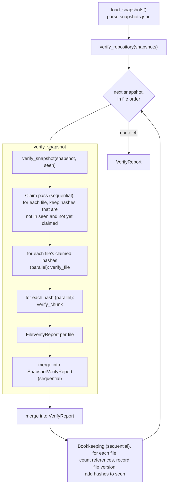

# Snapr Verification Design (v1)

`snapr verify` answers one question: **is every chunk that any snapshot refers to present in the object store and intact?** This document describes how v1 answers it, what each number in the report means, and what a passing result does and does not tell you.

It describes the implementation in [`src/verification/verifier.rs`](../src/verification/verifier.rs) and the behavior covered by [`tests/test_verify.rs`](../tests/test_verify.rs). The object layout that verification checks is specified in [storage-format.md](storage-format.md).

**Contents**

1. [Overview](#1-overview)
2. [Pipeline](#2-pipeline)
3. [Verifying one chunk](#3-verifying-one-chunk)
4. [Integrity issues](#4-integrity-issues)
5. [Duplicate references](#5-duplicate-references)
6. [Parallelism and aggregation](#6-parallelism-and-aggregation)
7. [Report metrics](#7-report-metrics)
8. [Output and exit status](#8-output-and-exit-status)
9. [Why there is no persistent verification cache](#9-why-there-is-no-persistent-verification-cache)
10. [What verification establishes](#10-what-verification-establishes)
11. [Tests](#11-tests)
12. [Gaps and ambiguous semantics](#12-gaps-and-ambiguous-semantics)

---

## 1. Overview

Verification starts from the snapshot manifests and works down to the stored objects:

```text
snapshots.json ─▶ snapshots ─▶ file versions ─▶ chunk references ─▶ unique chunks ─▶ object files
```

- A **snapshot** lists files. Each file entry is a path and an ordered list of chunk hashes.
- A **file version** is one distinct `(path, chunk hash list)` pair. The same file unchanged across ten snapshots is one file version.
- A **chunk reference** is one hash in one file entry. Many references can name the same chunk.
- A **unique chunk** is one distinct hash. It corresponds to at most one object file, `.snapr/objects/<hash>`.

Every unique chunk that is referenced is verified exactly once per run. Verification is read-only: it changes nothing in the repository or the workspace.

Inputs and non-inputs:

| Read by `verify` | Not read by `verify` |
| --- | --- |
| `.snapr/snapshots.json` (loaded by `main` before the handler runs) | `.snapr/config.json` |
| Object files named by the snapshots | `.snapr/workspace_index.json` |
| | Object files that no snapshot names |
| | The workspace files |

---

## 2. Pipeline

The call chain is `handle_verify` → `verify_repository` → `verify_snapshot` → `verify_file` → `verify_chunk`.



Step by step:

1. **Load.** `main` parses `snapshots.json` into a list of snapshots. If the file is missing or malformed, the command fails here and no verification runs.
2. **Iterate snapshots.** `verify_repository` visits snapshots in the order they appear in the file, which is creation order. It keeps two sets for the duration of the run:
   - `verified_chunks`, the set of every hash seen in snapshots already processed. Despite its name it holds all hashes seen so far, including those that had issues.
   - `verified_files`, the set of distinct `(path, chunk hash list)` pairs.
3. **Claim.** `verify_snapshot` walks the snapshot's files in order and builds, for each file, the list of hashes that need verifying. A hash is kept only if it is not in `verified_chunks` and has not already been claimed earlier in this snapshot. This pass is sequential.
4. **Verify.** The per-file lists are processed in parallel. Each list is passed to `verify_file`, which verifies its hashes in parallel with `verify_chunk`.
5. **Aggregate.** Per-chunk results are folded into a `FileVerifyReport`, per-file reports into a `SnapshotVerifyReport`, and that into the `VerifyReport`.
6. **Bookkeeping.** After a snapshot is verified, `verify_repository` walks its files once more to count references, record file versions, and add every hash to `verified_chunks`.
7. **Finish.** When all snapshots are done, the sizes of the two sets become `total_chunks` and `unique_file_versions_checked`.

---

## 3. Verifying one chunk

`verify_chunk(hash)` reads the whole object file into memory and applies the checks below in order. It stops at the first check that fails and reports that one issue. A chunk therefore produces either one success or exactly one issue.

| Step | Check | Issue on failure |
| --- | --- | --- |
| 1 | `.snapr/objects/<hash>` can be read. | `MissingChunk` |
| 2 | The file is at least 16 bytes (the header size). | `InvalidHeader` |
| 3 | Bytes 0–4 are the magic `SNAPR`. | `InvalidHeader` |
| 4 | Byte 7 is a defined compression identifier (`0` = None, `1` = Zstd). | `InvalidHeader` |
| 5 | The compression identifier is Zstd. | `UnsupportedCompression` |
| 6 | Everything after byte 15 decodes as Zstandard. | `UndecodablePayload` |
| 7 | The decoded length equals the header's original-size field (bytes 8–15, little-endian `u64`). | `CorruptedChunk` |
| 8 | The SHA-256 of the decoded bytes, in lowercase hex, equals `hash`. | `HashMismatch` |

Notes on individual steps:

- **Step 1** treats every read error as a missing object, not only "file not found".
- **Step 4** is performed by `ObjectHeader::extract` ([`src/storage/models/object_header.rs`](../src/storage/models/object_header.rs)), which also parses the version byte (offset 5) and flags byte (offset 6). Their values are ignored.
- **Step 5** exists because the identifier `0` (None) is defined in the format but v1 has no code to read an uncompressed payload.
- **Step 8** is the check that ties an object to its name. It is what makes the store content-addressed in practice: an object that passes holds exactly the bytes that were hashed when the chunk was saved.

A successful result carries the hash and the original size, which is added to the report's byte count.

---

## 4. Integrity issues

Issues are values of the `VerifyIssue` enum in [`src/models/reports.rs`](../src/models/reports.rs). They are collected in the report; they are not errors, and finding one does not stop the run.

| Variant | Fields | Meaning | Typical cause |
| --- | --- | --- | --- |
| `MissingChunk` | `hash` | The object file could not be read. | The file was deleted, never fully written, or is unreadable. |
| `InvalidHeader` | `hash` | The object is shorter than 16 bytes, does not start with `SNAPR`, or has an undefined compression identifier. | Truncation, or the file was overwritten with unrelated data. |
| `UnsupportedCompression` | `hash`, `compression` | The header is well-formed but names a compression type v1 cannot read. | An object written with compression `0`. v1 never writes one. |
| `UndecodablePayload` | `hash` | The header is valid but the payload is not a decodable Zstandard stream. | Damage to the payload bytes. |
| `CorruptedChunk` | `hash` | The payload decodes, but to a different number of bytes than the header records. | Damage to the header's size field, or a payload replaced by another valid stream. |
| `HashMismatch` | `expected`, `actual` | The payload decodes to the recorded length, but its SHA-256 is not the object's name. | The object's content was replaced, for example by another object's bytes. |

Each issue is printed with the message defined on its variant, for example:

```text
missing chunk: fef026b2a2f50ac0dbe98acf6e2db9c75ab6fbc01511250b24b32bed38c4e83e
payload could not be decompressed for chunk: 2d711642b726b04401627ca9fbac32f5c8530fb1903cc4db02258717921a4881
```

An issue identifies a chunk by hash. It does not say which snapshots or files use that chunk.

---

## 5. Duplicate references

The same chunk is commonly referenced many times. Verification handles three cases, and in each the chunk is verified once.

| Case | Example | Mechanism |
| --- | --- | --- |
| Across snapshots | A file unchanged between snapshot 1 and snapshot 2. | The hash is in `verified_chunks` after snapshot 1, so snapshot 2 skips it. |
| Across files in one snapshot | Two files with identical content. | The claim pass gives the hash to the first file; the second file's list omits it. |
| Within one file | A file whose chunk list repeats a hash, such as a large file of zeros. | The claim pass keeps the first occurrence only. |

Consequences:

- A chunk is checked in the first snapshot (in file order) that references it, on behalf of the first file (in manifest order) that references it.
- A damaged chunk produces **one** issue per run, no matter how many snapshots and files reference it.
- A chunk that had an issue is also added to `verified_chunks`, so it is not re-checked or re-reported in later snapshots.
- Later snapshots usually have little to verify, because most of their chunks were first seen earlier.

### Worked example

A repository with two snapshots:

| Snapshot | File | Chunk hashes |
| --- | --- | --- |
| 1 | `a.txt` | `H1` |
| 1 | `b.txt` | `H1` (same content as `a.txt`) |
| 1 | `big.bin` | `H2`, `H2`, `H3` |
| 2 | `a.txt` | `H1` |
| 2 | `b.txt` | `H4` (edited) |
| 2 | `big.bin` | `H2`, `H2`, `H3` |

Claim pass for snapshot 1: `a.txt` claims `H1`; `b.txt` claims nothing; `big.bin` claims `H2` and `H3`. Three chunks are verified.

Claim pass for snapshot 2: `H1`, `H2`, and `H3` are already seen. `b.txt` claims `H4`. One chunk is verified.

Resulting report, assuming all objects are intact:

| Metric | Value | Why |
| --- | --- | --- |
| Snapshots checked | 2 | |
| File versions checked | 4 | `a.txt`/`H1`, `b.txt`/`H1`, `b.txt`/`H4`, `big.bin`/`H2,H2,H3` |
| Chunks referenced | 10 | 5 references in each snapshot |
| Chunks unique | 4 | `H1`, `H2`, `H3`, `H4` |
| Chunks verified | 4 | each unique chunk checked once |
| Issues | 0 | |

---

## 6. Parallelism and aggregation

Verification uses Rayon's default global thread pool at two nested levels:

| Level | Function | Parallel over |
| --- | --- | --- |
| Outer | `verify_snapshot` | the files of one snapshot (their claimed hash lists) |
| Inner | `verify_file` | the claimed hashes of one file |

Everything else runs on the calling thread: the loop over snapshots, the claim pass, the merging of reports, and the bookkeeping after each snapshot.

Properties of this arrangement:

- **Workers share no mutable state.** `verify_chunk` takes a hash and returns a result. The `seen` set is only read during the parallel phase, and it is updated between snapshots, not during one.
- **The claim pass must be sequential.** It decides which file owns each hash. Doing that before the parallel phase is what guarantees a chunk is not verified by two workers at once.
- **Results are collected, then folded.** Each parallel stage collects its results into a vector and merges them in a plain loop. Rayon's ordered collection preserves input order, so issues appear in a deterministic order: by snapshot, then by file, then by position in the file's chunk list.
- **Snapshots are processed one at a time.** There is no parallelism across snapshots. This is what allows a later snapshot to skip everything an earlier one covered.
- **Memory.** Each worker holds one object file and its decompressed content at a time. An object's content is at most 4 MiB, so peak memory scales with the number of worker threads, not with repository size.

### Report types

| Type | Scope | Built by |
| --- | --- | --- |
| `ChunkVerificationResult` | one chunk: `Verified { hash, original_size }` or `Issue(VerifyIssue)` | `verify_chunk` |
| `FileVerifyReport` | one file's claimed chunks | `FileVerifyReport::record`, once per chunk |
| `SnapshotVerifyReport` | one snapshot | `SnapshotVerifyReport::merge`, once per file |
| `VerifyReport` | the whole run | `VerifyReport::merge`, once per snapshot, plus the bookkeeping in `verify_repository` |

Each level sums `chunks_verified` and `bytes_verified` and concatenates `issues`.

---

## 7. Report metrics

`VerifyReport` is defined in [`src/models/reports.rs`](../src/models/reports.rs). The "Label" column is the text printed by the CLI.

| Field | Label | Definition |
| --- | --- | --- |
| `snapshots_checked` | Snapshots → Checked | The number of snapshots in `snapshots.json`. |
| `unique_file_versions_checked` | File versions → Checked | The number of distinct `(path, ordered chunk hash list)` pairs across all snapshots. |
| `total_chunks` | Chunks → Unique | The number of distinct chunk hashes across all file entries of all snapshots. |
| `chunks_referenced` | Chunks → Referenced | The total number of chunk hashes across all file entries of all snapshots, counting every repetition. |
| `chunks_verified` | Chunks → Verified | The number of distinct chunks whose object passed every check. |
| `issues` | Chunks → Issues (count), then the list | One entry for each distinct chunk whose object failed a check. |
| `bytes_verified` | Data → Content verified | The sum of the uncompressed sizes of the chunks counted in `chunks_verified`. |

Precise points:

- **`snapshots_checked`** counts snapshots visited, whether or not they had anything left to verify.
- **`unique_file_versions_checked`** is a count of manifest entries, not of verification outcomes. The same content at two paths is two file versions. A file version is counted even if its chunks were first verified on behalf of another file, even if some of its chunks have issues, and even if it is an empty file with no chunks.
- **`total_chunks`** includes chunks that had issues. It is the number of objects the repository needs, not the number found.
- **`chunks_referenced`** measures how much the snapshots reuse chunks. `chunks_referenced − total_chunks` is the number of references that were satisfied without storing or verifying another object.
- **`bytes_verified`** counts each unique chunk once. It is the amount of distinct uncompressed content confirmed intact. It is not the combined size of the snapshots and not the on-disk size of the object store.
- The CLI prints byte counts in decimal units (1 KB = 1000 B).

### Relationships

Because every unique chunk is verified exactly once and yields either a success or one issue:

```text
total_chunks = chunks_verified + issues.len()
total_chunks ≤ chunks_referenced
```

A clean repository is therefore one where `issues` is empty, which is equivalent to `chunks_verified == total_chunks`.

### Fields that are not surfaced

`SnapshotVerifyReport.files_checked` is incremented once per file per snapshot but is not copied into `VerifyReport` and is never displayed.

---

## 8. Output and exit status

The handler and the CLI are separate layers:

| Layer | Behavior |
| --- | --- |
| `handle_verify` (library) | Returns `Ok(VerifyReport)` whenever verification ran to completion, with or without issues. Returns `Err` only if something outside the per-chunk checks failed. |
| `ui::print_verify_report` | Prints the report to stdout. |
| `main` | After printing, if `issues` is not empty, returns an error, which prints a summary line to stderr and sets the exit code. |

| Outcome | First line | Exit code |
| --- | --- | --- |
| No issues | `✓ Repository verified` | 0 |
| One or more issues | `✗ Repository verification failed` | 1 |
| `snapshots.json` missing or unparsable | `✗ <error>` only, no report | 1 |

A clean run:

```text
✓ Repository verified

────────────────────────────────────────

Snapshots
  Checked           : 2

File versions
  Checked           : 4

Chunks
  Unique            : 4
  Referenced        : 5
  Verified          : 4
  Issues            : 0

Data
  Content verified  : 33 B

✓ No integrity issues found.
```

The same repository after one object's payload was overwritten and another object was deleted:

```text
✗ Repository verification failed

────────────────────────────────────────

Snapshots
  Checked           : 2

File versions
  Checked           : 4

Chunks
  Unique            : 4
  Referenced        : 5
  Verified          : 2
  Issues            : 2

Data
  Content verified  : 20 B

Issues
  ✗ payload could not be decompressed for chunk: 2d711642b726b04401627ca9fbac32f5c8530fb1903cc4db02258717921a4881
  ✗ missing chunk: fef026b2a2f50ac0dbe98acf6e2db9c75ab6fbc01511250b24b32bed38c4e83e
✗ 2 integrity issue(s) found
```

Both listings are output from the v1 binary on a small test repository.

A repository with no snapshots verifies as clean with every count at zero.

---

## 9. Why there is no persistent verification cache

Every run of `snapr verify` reads, decompresses, and hashes every referenced chunk again. Nothing is recorded on disk about earlier runs. The only memory is the in-process `seen` set, which is discarded when the command exits.

The source does not state a rationale for this. The reasoning below is inferred from how the rest of the design behaves.

- **A cache would answer a different question.** Verification exists to detect damage that happens to objects at rest: deletion, truncation, bit rot, or accidental overwrites. A record that says "this object passed last week" says nothing about its bytes today. Skipping objects on that basis would turn a corruption check into a check that nothing new has been added.
- **A cache would itself be unverified state.** Snapr's metadata files are plain JSON with no checksums. A cache of verified hashes would be one more mutable file whose own correctness verification would have to assume.
- **Snapr already has a trusted cache, and verify is its counterweight.** The workspace index lets `save` skip unchanged files and assume their objects exist, without checking. That is a deliberate trade of certainty for speed. `verify` deliberately does not read the index or the config; it is the one command that takes nothing on trust except the manifests.
- **Content addressing makes full re-verification self-contained.** An object's expected hash is its file name. Verifying it needs no stored expectation other than the manifests, so there is nothing a cache would add to correctness.

The cost is that verification time grows with the amount of unique stored content. The in-run deduplication described in [section 5](#5-duplicate-references) keeps that cost proportional to unique chunks, not to the number of snapshots.

---

## 10. What verification establishes

### A run with no issues establishes

At the time each object was read, for every chunk referenced by any snapshot in `snapshots.json`:

- the object file exists and is readable;
- it has a well-formed header with the `SNAPR` magic and the Zstd compression identifier;
- its payload decompresses;
- the decompressed length matches the header;
- the decompressed bytes hash to the object's name.

It follows that **every file in every snapshot can be reconstructed with exactly the bytes its manifest describes**, since a file is the concatenation of its chunks in manifest order and every one of those chunks is intact.

### It does not establish

| Not covered | Detail |
| --- | --- |
| **That the manifests are correct.** | `snapshots.json` is the trusted input. If a file entry's hash list were altered to name other valid chunks, verification would pass. The file has no checksum. |
| **Structural validity of snapshot metadata.** | Beyond parsing, nothing checks ids, timestamps, statistics, or that paths are sensible. |
| **Snapshot ancestry.** | `parent_id` values are not examined. |
| **`config.json` and `workspace_index.json`.** | Neither file is read. A wrong current-snapshot pointer or a stale index is not detected. |
| **The workspace.** | Verification says nothing about whether the working files match any snapshot. Use `snapr status` for that. |
| **Unreferenced objects.** | Object files that no snapshot names are not examined, counted, or reported. |
| **The header's version and flags bytes.** | They are parsed and ignored. |
| **Future state.** | The result describes the moment of reading. Nothing prevents an object from being damaged afterwards. |
| **That a restore will succeed.** | Restore can still fail for reasons outside the object store, such as permissions or disk space in the workspace. |
| **Collision resistance.** | Verification relies on SHA-256: it treats matching digests as matching content. |

### When issues are reported

An issue means at least one file version cannot be reconstructed from the store. The report names the chunk but not the affected snapshots or files, and v1 has no repair command. Restoring a snapshot that needs a damaged chunk fails or, for a `HashMismatch`, writes the wrong content, because the restore path does not check hashes (see [storage-format.md, section 9](storage-format.md#9-reading-objects)).

---

## 11. Tests

[`tests/test_verify.rs`](../tests/test_verify.rs) exercises the pipeline through `handle_verify` on real temporary repositories.

| Test | Establishes |
| --- | --- |
| `verify_clean_repo_has_no_issues` | A fresh repository has no issues and `chunks_verified == chunks_referenced` when there is no sharing. |
| `verify_deleted_chunk_produces_missing_chunk_issue` | A deleted object yields one `MissingChunk` with the right hash. |
| `verify_corrupt_magic_produces_invalid_header` | Overwritten magic bytes yield `InvalidHeader`. |
| `verify_undecodable_payload_produces_issue_and_continues` | A garbage payload yields `UndecodablePayload`, the run completes, and other chunks are still verified. |
| `verify_wrong_original_size_produces_corrupted_chunk` | A wrong size field yields `CorruptedChunk`. |
| `verify_hash_mismatch_produces_hash_mismatch_issue` | Two swapped objects yield `HashMismatch`. |
| `verify_deduplicates_chunk_verification_across_snapshots` | Counts stay consistent when two snapshots share a chunk. |
| `verify_deduplicates_chunk_shared_by_files_in_one_snapshot` | Two identical files: 2 references, 1 unique, 1 verified. |
| `verify_reports_shared_damaged_chunk_once` | A damaged chunk shared by two files yields one issue. |
| `verify_deduplicates_chunk_repeated_within_one_file` | A file with a repeated chunk: 2 references, 1 unique, 1 verified. |
| `verify_counts_are_consistent` | Basic count sanity for a two-file snapshot. |
| `verify_empty_snapshots_is_clean` | No snapshots gives a zero report with no issues. |

Not covered by a test: the `UnsupportedCompression` variant, an `InvalidHeader` caused by truncation or by an undefined compression byte inside `verify`, the exit code and printed output of the CLI, and the order of issues.

---

## 12. Gaps and ambiguous semantics

Points found while documenting the implementation.

1. **`verified_chunks` is misnamed.** The set holds every hash seen so far, including those with issues. "Seen" is the accurate meaning; this document uses that word.
2. **"File versions checked" counts manifest entries, not checks.** The name suggests each counted file was verified. It is the number of distinct `(path, hash list)` pairs, including files with damaged chunks and files that claimed no chunks.
3. **Issues do not identify affected files or snapshots.** The data to do so is available at the point of the claim pass but is not carried into the report.
4. **`MissingChunk` covers all read errors.** A permissions problem on an existing object is reported as missing.
5. **`CorruptedChunk` and `HashMismatch` depend on check order.** An object whose decoded length disagrees with its header is never hash-checked, so the two variants do not partition damage into distinct kinds.
6. **Version and flags are unchecked.** An object with an unexpected version or non-zero flags verifies successfully if the rest of it is valid.
7. **`files_checked` is computed and discarded.** `SnapshotVerifyReport.files_checked` has no consumer.
8. **Set capacity uses the file count.** `verified_chunks` is pre-sized by the number of file entries, not the number of chunk references. This affects only allocation, not results.
9. **Error propagation is effectively unused.** `verify_chunk` returns a `Result`, but every failure it can encounter is now mapped to an issue. The `Err` path through `verify_file` and `verify_snapshot` remains in the signatures.
10. **A header-parsing `TODO` remains.** `verify_chunk` checks the length and magic itself before calling `ObjectHeader::extract`, which re-checks the length. A comment marks this for consolidation.
11. **Trailing bytes after the compressed stream.** The whole remainder of the file is given to the Zstandard decoder. How extra bytes after a valid frame are treated is decided by the `zstd` crate and is not tested here.
12. **The rationale in section 9 is inferred.** The repository contains no written design decision about a verification cache.
